<p align="center">
  
</p>

<p align="center">
  <a href="https://www.linkedin.com/in/missaoui-raslen-6a8620298/"></a>
  <a href="https://twitter.com/RaslenMiss45861"></a>
  
</p>

---

### About Me

DevOps & Cloud Engineer focused on building automated, secure, and scalable infrastructures. I design CI/CD pipelines, deploy Kubernetes clusters, implement GitOps workflows, and set up production monitoring stacks.

```yaml
role:      DevOps & Cloud Engineer
location:  Tunisia
focus:     [ CI/CD, Infrastructure as Code, GitOps, Observability ]
working:   Multi-tenant architectures & production-grade deployments
mindset:   Automate it, secure it, then make it observable
```

---

### Featured Work

#### Recent work

<p align="center">
  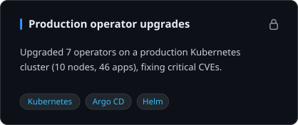
  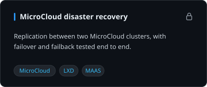
</p>

<p align="center">
  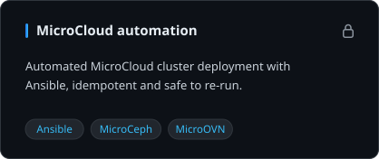
  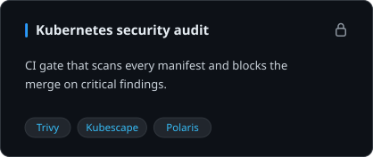
</p>

<p align="center">
  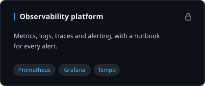
  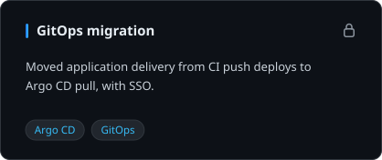
</p>

#### Open source

<p align="center">
  <a href="https://github.com/raslenraslen/ansible-kubeadm-cluster">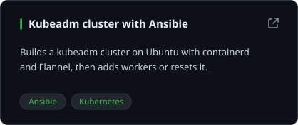</a>
  <a href="https://github.com/raslenraslen/devsecops-ansible-platforme">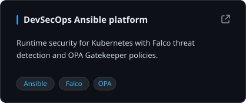</a>
</p>

<p align="center">
  <a href="https://github.com/raslenraslen/kubernetes-ingress-tls-mastery">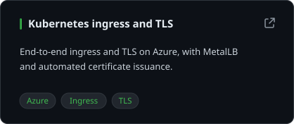</a>
  <a href="https://github.com/raslenraslen/k8s-opa-gatekeeper">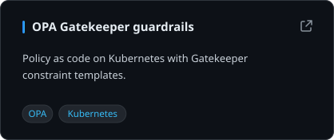</a>
</p>

<p align="center">
  <a href="https://github.com/raslenraslen/MetalLB-Configuration">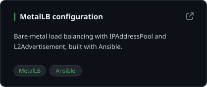</a>
  <a href="https://github.com/raslenraslen/projet-openstack">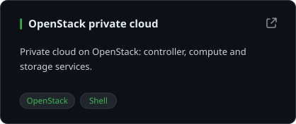</a>
</p>

---

### Tech Stack

| Domain | Tools |
|---|---|
| **Cloud & Infra** |       ![Azure][azure]      |
| **Networking & Data** |       |
| **CI/CD & GitOps** |        |
| **Observability** |          |
| **Security** |            |
| **Languages** |     |

---

### GitHub Stats

> Cards below are generated by a [GitHub Action](.github/workflows/profile-cards.yml) running in this repo and committed as static SVGs, so no third-party API is called at render time.

<p align="center">
  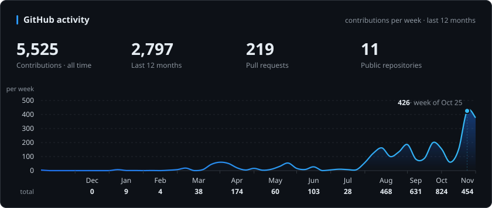
</p>

<p align="center">
  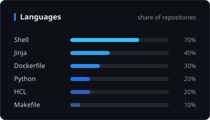
  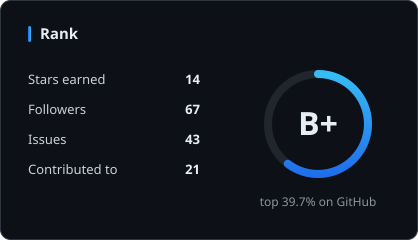
</p>

<p align="center">
  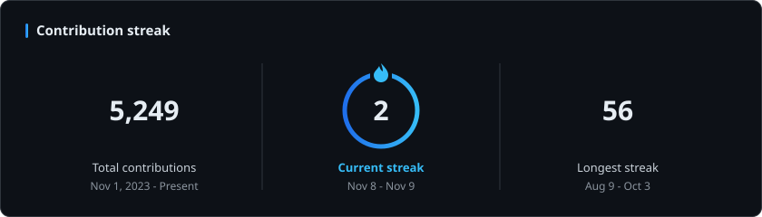
</p>

---

### Contribution Snake

<p align="center">
  <picture>
    <source media="(prefers-color-scheme: dark)" srcset="https://raw.githubusercontent.com/raslenraslen/raslenraslen/output/github-snake-dark.svg" />
    <source media="(prefers-color-scheme: light)" srcset="https://raw.githubusercontent.com/raslenraslen/raslenraslen/output/github-snake.svg" />
    
  </picture>
</p>

---

### Spotify

<p align="center">
  <a href="https://github.com/kittinan/spotify-github-profile">
    
  </a>
</p>

---

<p align="center">
  
</p>


<!-- Badge logos for LinkedIn / Azure were removed from simple-icons (brand takedowns),
     so the archived icons are embedded as data URIs instead of shields' logo= slugs.
     The AWS badge is committed under assets/badges/: its data-URI URL was too long for GitHub's image proxy. -->
[azure]: https://img.shields.io/badge/Azure-0078D4?style=flat-square&logo=data%3Aimage%2Fsvg%2Bxml%3Bbase64%2CPHN2ZyByb2xlPSJpbWciIHZpZXdCb3g9IjAgMCAyNCAyNCIgeG1sbnM9Imh0dHA6Ly93d3cudzMub3JnLzIwMDAvc3ZnIj48dGl0bGU%2BTWljcm9zb2Z0IEF6dXJlPC90aXRsZT48cGF0aCBkPSJNMjIuMzc5IDIzLjM0M2ExLjYyIDEuNjIgMCAwIDAgMS41MzYtMi4xNHYuMDAyTDE3LjM1IDEuNzZBMS42MiAxLjYyIDAgMCAwIDE1LjgxNi42NTdIOC4xODRBMS42MiAxLjYyIDAgMCAwIDYuNjUgMS43NkwuMDg2IDIxLjIwNGExLjYyIDEuNjIgMCAwIDAgMS41MzYgMi4xMzloNC43NDFhMS42MiAxLjYyIDAgMCAwIDEuNTM1LTEuMTAzbC45NzctMi44OTIgNC45NDcgMy42NzVjLjI4LjIwOC42MTguMzIuOTY2LjMybS0zLjA4NC0xMi41MzEgMy42MjQgMTAuNzM5YS41NC41NCAwIDAgMS0uNTEuNzEzdi0uMDAxaC0uMDNhLjU0LjU0IDAgMCAxLS4zMjItLjEwNmwtOS4yODctNi45aDQuODUzbTYuMzEzIDcuMDA2Yy4xMTYtLjMyNi4xMy0uNjk0LjAwNy0xLjA1OEw5Ljc5IDEuNzZhMS43MjIgMS43MjIgMCAwIDAtLjAwNy0uMDJoNi4wMzRhLjU0LjU0IDAgMCAxIC41MTIuMzY2bDYuNTYyIDE5LjQ0NWEuNTQuNTQgMCAwIDEtLjMzOC42ODQiLz48L3N2Zz4%3D&logoColor=white
